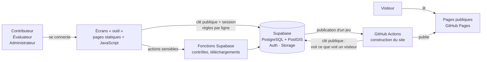

# 01 — Architecture technique

> Livrable de conception n° 1. Statut : **validé** le 17 novembre 2026.
> Décisions liées : ADR-12 à ADR-16 dans [`docs/decisions.md`](../decisions.md).

## 1. Principe

La plateforme garde le site actuel (pages générées en Python) et lui ajoute **Supabase** comme cœur : base de données PostgreSQL avec PostGIS, comptes, fichiers et règles d'accès. Il n'y a **pas de serveur applicatif à nous** : tout ce qui demande des droits particuliers passe par la base (règles par ligne) ou par de petites fonctions hébergées chez Supabase.



## 2. Les composants

| Composant | Rôle | Technologie | Coût |
| --- | --- | --- | --- |
| **Pages publiques** | Accueil, catalogue, fiches, carte, indicateurs, projets, pages de texte | HTML généré par `scripts/build_site.py`, hébergé sur GitHub Pages | Gratuit |
| **Écrans « outil »** | Connexion, mes soumissions, dépôt, file de revue, administration | Pages statiques + modules JavaScript (sans framework) + bibliothèque `supabase-js` hébergée avec le site | Gratuit |
| **Base de données** | Toutes les données, avec leur statut et leur historique | PostgreSQL + PostGIS (Supabase) | Gratuit jusqu'à 500 Mo |
| **Comptes** | Inscription, connexion, rôles | Supabase Auth | Gratuit |
| **Fichiers** | Fichiers déposés et fichiers publiés | Supabase Storage | Gratuit jusqu'à 1 Go |
| **Fonctions** | Contrôles techniques d'un fichier, lien de téléchargement, déclenchement de la reconstruction du site | Supabase Edge Functions (TypeScript) | Gratuit (quota mensuel) |
| **Construction et tâches planifiées** | Reconstruire le site, sauvegarder la base chaque nuit, garder le projet Supabase actif | GitHub Actions | Gratuit (dépôt public) |
| **Envoi des e-mails** | Liens de connexion, réinitialisation, notifications | Service SMTP externe (offre gratuite, à choisir) | Gratuit en dessous d'un quota |

## 3. Comment chaque besoin est couvert

### 3.1 Les pages publiques restent statiques

- La construction lit la base avec la **clé publique** (rôle `anon`), donc **exactement** ce qu'un visiteur a le droit de voir. Une donnée restreinte ne peut pas fuiter dans le site public, même par erreur de code (ADR-14).
- Avantages conservés : pages légères, rapides sur une connexion faible, lisibles sans JavaScript, bien référencées.
- **Mise à jour** : quand un jeu est publié, une fonction Supabase demande à GitHub de reconstruire le site (quelques minutes). Une reconstruction a aussi lieu chaque nuit.
- Le fichier `donnees/jeux-demo.json` reste la source **tant que la base est vide**, puis sert de données d'essai.

### 3.2 Les écrans « outil » parlent directement à Supabase

- Ce sont des pages du site comme les autres (`/fr/espace/…`), mais leur contenu est chargé après la connexion.
- Le navigateur utilise la clé publique **et la session de l'utilisateur**. La base décide, ligne par ligne, ce qu'il peut lire et modifier : un contributeur ne voit que ses soumissions, un évaluateur la file de revue, un administrateur tout (ADR-13).
- Code JavaScript **en modules** (un fichier par écran, un module commun pour la connexion, les messages d'erreur et la traduction), sans étape de compilation : rien à installer sur l'ordinateur de développement.

### 3.3 Les actions sensibles passent par des fonctions

Certaines actions ne doivent pas dépendre du navigateur :

| Fonction | Rôle |
| --- | --- |
| `controler-fichier` | Contrôles techniques automatiques d'un fichier déposé (EF-08) : format lisible, colonnes, unités, coordonnées valides, doublons évidents. Le résultat est enregistré dans `quality_checks` |
| `telecharger` | Vérifie la licence et le niveau d'accès, compte le téléchargement, puis renvoie un lien temporaire vers le fichier |
| `publier` | Appelée par une décision de publication : fige la version, copie le fichier dans l'espace public, demande la reconstruction du site |

Ces fonctions utilisent la **clé de service**, qui ne quitte jamais les secrets de Supabase.

### 3.4 Les fichiers

| Espace de stockage | Contenu | Accès |
| --- | --- | --- |
| `depots` | Fichiers déposés, en attente de revue | Privé : le contributeur (ses fichiers), les évaluateurs, les administrateurs |
| `publies` | Fichiers des versions publiées | Lecture par lien temporaire, via la fonction `telecharger` |

Chaque fichier a une **empreinte** (SHA-256) enregistrée en base : elle prouve que le fichier téléchargé est bien celui qui a été validé. Les fichiers trop volumineux pour l'offre gratuite (rasters) restent hébergés chez leur producteur ou sur Zenodo, avec un lien.

## 4. Sécurité

| Règle | Application |
| --- | --- |
| Clés | La clé publique (`anon`) peut figurer dans le code : seule, elle ne donne accès qu'aux données publiques. La clé de service n'est **jamais** dans le dépôt : uniquement dans les secrets GitHub Actions et Supabase |
| Règles par ligne (RLS) | Activées sur **toutes** les tables. Aucune table n'est lisible sans règle explicite |
| Droits d'accès explicites | Depuis 2026, les nouveaux projets Supabase n'ouvrent plus automatiquement les tables à l'API : chaque table reçoit ses `GRANT` dans la migration, en plus de ses règles RLS |
| Rôles | Stockés en base (table `profiles`), jamais déduits du navigateur |
| Journal | Chaque décision et chaque action sensible écrit une ligne dans `audit_log` (qui, quoi, quand, résultat) |
| Données sensibles | Coordonnées d'espèces menacées, sites vulnérables : généralisées ou restreintes avant publication (cahier des charges § 10) |
| Données personnelles | Le minimum : nom affiché, e-mail, organisation. Jamais publiés sans accord |

## 5. Contraintes de l'offre gratuite de Supabase

Vérifiées le 17 novembre 2026 (sources : documentation officielle et guides tarifaires 2026).

| Contrainte | Conséquence | Mesure |
| --- | --- | --- |
| 500 Mo de base, 1 Go de fichiers, 5 Go de trafic sortant par mois | Suffisant pour le pilote | Gros fichiers hébergés ailleurs, avec un lien |
| Le projet se met en pause après 7 jours sans activité | Les écrans « outil » ne répondraient plus | La construction nocturne lit la base chaque jour, ce qui garde le projet actif |
| **Pas de sauvegarde** sur l'offre gratuite | Une erreur peut tout effacer | Export nocturne de la base par GitHub Actions, **chiffré** avant d'être stocké (le dépôt est public) |
| L'envoi d'e-mails intégré ne fonctionne que pour l'équipe, 2 par heure | Les utilisateurs ne recevraient pas leur lien de connexion | Brancher un service SMTP externe gratuit avant d'ouvrir les comptes |
| Projets créés après le 30 mai 2026 : tables non exposées par défaut | Une table oubliée renvoie une erreur d'accès | `GRANT` explicites dans chaque migration |

## 6. Environnements

| Environnement | Base | Site |
| --- | --- | --- |
| **Développement** | Projet Supabase « gb-dev » (gratuit) | Site construit localement (`python scripts/build_site.py`) |
| **Production** | Projet Supabase « gb-prod » (gratuit, 2 projets actifs maximum) | GitHub Pages |

Pas de base locale (pas de Docker sur l'ordinateur de développement) : le développement se fait contre le projet « gb-dev ».

## 7. Organisation du code

```
supabase/
  migrations/        Schéma de la base, en SQL numéroté (0001_…, 0002_…) : la seule façon de le modifier
  functions/         Fonctions Supabase (controler-fichier, telecharger, publier)
  tests/             Tests des règles d'accès (un scénario par rôle)
scripts/
  build_site.py      Construction du site ; lit la base (ou le JSON de démonstration)
gabarits/espace/     Gabarits des écrans « outil »
site/assets/js/espace/  Modules JavaScript des écrans « outil »
docs/conception/     Livrables de conception
```

## 8. Ce qui reste ouvert

- **Fournisseur SMTP** : à choisir parmi les offres gratuites, au moment d'ouvrir les comptes.
- **Fond de carte** pour la production (ADR-10).
- **Nom de domaine** : après le choix du nom définitif.
