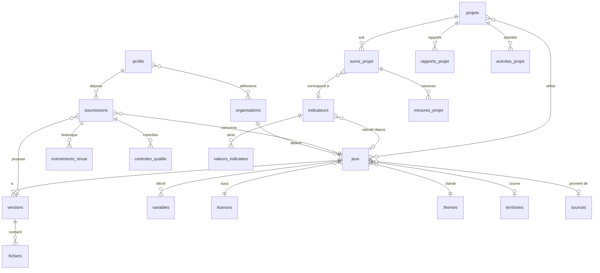
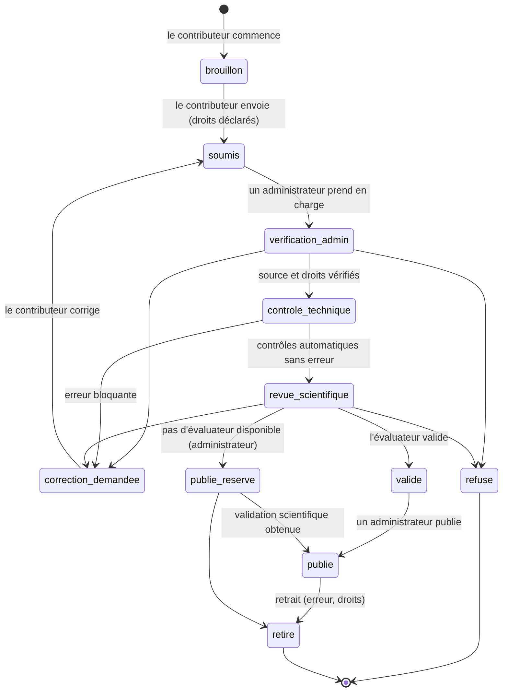

# 02 — Modèle de données (MVP)

> Livrable de conception n° 2. Statut : **validé** le 17 novembre 2026.
> Base : cahier des charges v2.0, § 11 (modèle conceptuel) et § 10 (statuts, confidentialité, qualité).
> Prochaine étape : traduction en SQL (`supabase/migrations/0001_schema.sql`) avec les règles d'accès et leurs tests.

## 1. Règles de conception

| Règle | Application |
| --- | --- |
| Identifiants | Clé technique **UUID** + identifiant lisible séquentiel jamais réutilisé : `GB-DS-0001` (jeu), `GB-IND-0001` (indicateur), `GB-PRJ-0001` (projet), `GB-SUB-0001` (soumission) — ADR-16 |
| Textes bilingues | Colonnes JSON `{"fr": "…", "en": "…"}` ; la base refuse de publier si une langue manque — ADR-15 |
| Suppression | **Logique** (`supprime_le`) pour tout contenu validé ; jamais d'effacement physique d'une décision ou d'une version publiée |
| Historique | Les événements de revue et le journal d'audit sont **en ajout seul** : ni modification ni suppression |
| Démonstration | Colonne `est_demo` sur les contenus : les données fictives ne se confondent jamais avec les réelles |
| Intégrité | Clé étrangère sur chaque lien ; valeurs fermées par des types énumérés |
| Accès | Règles par ligne (RLS) sur **toutes** les tables + `GRANT` explicites — ADR-13 |
| Géographie | PostGIS, système WGS 84 (EPSG:4326) ; emprise d'un jeu = polygone ; territoire = multipolygone |
| Langue des noms | Noms de tables et de colonnes en français, comme le reste du code |

## 2. Vue d'ensemble

## 3. Les tables

Types : `uuid`, `texte`, `bilingue` (JSON fr/en), `entier`, `décimal`, `date`, `horodatage`, `géométrie`. Les champs en **gras** sont obligatoires.

### 3.1 Personnes et organisations

**`profils`** — un par compte (prolonge `auth.users` de Supabase)

| Champ | Type | Note |
| --- | --- | --- |
| **id** | uuid | = identifiant du compte Supabase |
| **nom_affiche** | texte | |
| **role** | énuméré | `contributeur` (par défaut), `evaluateur`, `administrateur` |
| **langue** | texte | `fr` ou `en` |
| **statut** | énuméré | `actif`, `suspendu` |
| specialites | texte | Pour les évaluateurs : domaines de compétence |
| cree_le | horodatage | |

L'e-mail reste dans `auth.users` (géré par Supabase), jamais dupliqué ni publié.

**`organisations`**

| Champ | Type | Note |
| --- | --- | --- |
| **id** | uuid | |
| **nom** | texte | |
| **type** | énuméré | `ong`, `institution_publique`, `recherche`, `entreprise`, `communaute`, `autre` |
| pays | texte | Code ISO 3166 (BJ) |
| site_web | texte | |
| **verifiee** | booléen | Vérifiée par un administrateur |

**`adhesions`** — lien profil ↔ organisation : **profil_id**, **organisation_id**, **role_orga** (`membre`, `gestionnaire`), depuis_le.

### 3.2 Référentiels

| Table | Champs | Contenu de départ |
| --- | --- | --- |
| **`themes`** | **code**, **libelle** (bilingue), ordre | forets, restauration, sols, eau, climat, biodiversite |
| **`licences`** | **code**, **nom** (bilingue), url, **telechargement_autorise**, **ouverte** | cc-by-4, cc-by-sa-4, cc0, odbl, conditions-source |
| **`territoires`** | **id**, code, **nom** (bilingue), **type** (`pays`, `departement`, `commune`, `zone`), pays, parent_id, geom (multipolygone) | Bénin, 12 départements, communes du pilote |
| **`sources`** | **id**, **organisme** (bilingue), url, citation, conditions | Global Forest Watch, ESA WorldCover… |

### 3.3 Jeux de données

**`jeux`** — la fiche d'un jeu (regroupe les tables `datasets` et `metadata` du cahier des charges, qui sont en relation 1-1)

| Champ | Type | Note |
| --- | --- | --- |
| **id**, **identifiant**, **slug** | uuid, texte, texte | `GB-DS-0001` ; slug unique pour l'adresse de la fiche |
| **titre**, **resume** | bilingue | |
| **theme** | → themes | |
| territoire_id | → territoires | |
| source_id | → sources | |
| **producteur** | bilingue | Qui a produit la donnée |
| **licence** | → licences | |
| **acces** | énuméré | `public`, `restreint`, `prive` (EF-09) |
| **statut_publication** | énuméré | `brouillon`, `en_revue`, `publie`, `publie_reserve`, `retire`, `archive` |
| **periode_debut**, **periode_fin** | entier (année) | |
| date_collecte | date | Distincte de la date de mise à jour (qualité « actualité ») |
| **methode**, **limites** | bilingue | |
| resolution, crs | texte | |
| emprise | géométrie (polygone) | Pour la carte |
| sensible | booléen | Coordonnées généralisées ou restreintes avant publication |
| organisation_id | → organisations | Organisation détentrice ; vide si le jeu est détenu par la personne qui l'a créé (décision n° 1, § 8) |
| **cree_par** | → profils | |
| **est_demo** | booléen | |
| cree_le, maj_le, supprime_le | horodatage | |

**`variables`** — **jeu_id**, **ordre**, **nom**, unite (bilingue), **description** (bilingue).

**`versions`** — chaque état publié d'un jeu

| Champ | Type | Note |
| --- | --- | --- |
| **id**, **jeu_id** | uuid | |
| **numero** | texte | `1.0`, `1.1`… unique par jeu |
| **note** | bilingue | Ce qui change |
| **statut** | énuméré | `en_revue`, `publiee`, `remplacee`, `refusee` |
| **auteur_id** | → profils | |
| publiee_le | horodatage | |

**`fichiers`** — **id**, **version_id**, **espace** (`depots` ou `publies`), **chemin**, **nom_original**, **format**, **taille**, **empreinte_sha256**, **depose_par**, depose_le. Un fichier publié n'est plus jamais modifié : une correction crée une nouvelle version.

### 3.4 Contribution et validation

**`soumissions`**

| Champ | Type | Note |
| --- | --- | --- |
| **id**, **identifiant** | uuid, texte | `GB-SUB-0001`, visible du contributeur (EF-06) |
| **type** | énuméré | `nouveau_jeu`, `nouvelle_version`, `correction` |
| **jeu_id**, version_id | → jeux, versions | |
| **contributeur_id** | → profils | |
| evaluateur_id | → profils | Évaluateur assigné |
| **statut** | énuméré | voir § 4 |
| **droits_declares** | booléen | Déclaration obligatoire des droits de partage (EF-05) |
| declaration | texte | Texte exact accepté, conservé |
| soumise_le, decidee_le | horodatage | Pour mesurer le délai de décision (objectif OS-4) |

**`evenements_revue`** — historique **en ajout seul** de chaque soumission (EF-07) : **soumission_id**, **auteur_id**, **action** (`commentaire`, `changement_statut`, `demande_correction`, `decision`), statut_avant, statut_apres, texte, **cree_le**.

**`controles_qualite`** — résultats des contrôles automatiques (EF-08) : **soumission_id**, fichier_id, **regle** (`format_lisible`, `colonnes`, `unites`, `coordonnees`, `doublons`…), **resultat** (`ok`, `avertissement`, `erreur`), detail (JSON), **execute_le**.

### 3.5 Indicateurs

**`indicateurs`** — **id**, **identifiant** (`GB-IND-0001`), **slug**, **titre**, **resume**, **definition**, **methode**, **limites** (bilingues), **theme**, territoire_id, **unite** (bilingue), **decimales**, **frequence** (`annuelle`, `mensuelle`, `ponctuelle`), **variation** (`relative`, `absolue`), jeu_source_id, responsable_id (responsable scientifique, cahier des charges § 13), **statut_publication**, **est_demo**.

**`valeurs_indicateur`** — **indicateur_id**, territoire_id, **periode** (`2023`, `2023-06`), **valeur** (décimal, **vide si manquante**), **nature** (`observee`, `estimation`, `declaree`), motif_absence, source_id, **statut**. Une valeur manquante est **une ligne avec une valeur vide**, pas une absence de ligne : la page la montre hachurée, jamais comblée.

### 3.6 Projets

| Table | Champs | Rôle |
| --- | --- | --- |
| **`projets`** | **id**, **identifiant** (`GB-PRJ-0001`), **slug**, **titre**, **resume**, **objectif** (bilingues), **theme**, territoire_id, **statut** (`en_cours`, `termine`), **debut**, fin, **porteur_organisation_id**, **visibilite** (`public`, `restreint`, `prive`), **gestionnaire_id**, **est_demo** | La fiche projet |
| **`projets_partenaires`** | **projet_id**, **organisation_id** | Partenaires |
| **`projets_jeux`** | **projet_id**, **jeu_id** | Jeux liés |
| **`suivis_projet`** | **id**, **projet_id**, **titre** (bilingue), **niveau** (`activite`, `resultat`, `effet`), **unite** (bilingue), **decimales**, indicateur_id (indicateur public correspondant), reference_valeur, reference_periode, **cible_valeur**, **cible_periode**, note (bilingue), ordre | Indicateurs suivis : référence et cible obligatoires (une référence absente est dite explicitement) |
| **`mesures_projet`** | **suivi_id**, **periode**, valeur (vide si manquante), nature, rapport_id | Historique des valeurs |
| **`rapports_projet`** | **id**, **projet_id**, **periode**, **statut** (`manquant`, `soumis`, `valide`), depose_le, fichier_id | Rapports d'avancement |
| **`activites_projet`** | **projet_id**, **libelle** (bilingue), **valeur**, **unite** (bilingue) | Moyens et activités (jamais présentés comme des effets) |

### 3.7 Suivi et audit

| Table | Champs | Règle |
| --- | --- | --- |
| **`journal_audit`** | **id**, acteur_id, **action**, **objet_type**, **objet_id**, details (JSON), **resultat**, **cree_le** | Écrit uniquement par des fonctions de la base ; lisible par les administrateurs ; jamais modifié |
| **`telechargements`** | **jeu_id**, **version_id**, profil_id (si connecté), **cree_le** | Pour l'indicateur d'usage ; aucune adresse IP stockée |

## 4. Le circuit d'une soumission

Le statut ne se modifie **jamais** directement : il passe par une fonction de la base, `changer_statut(soumission, nouveau_statut, texte)`, qui vérifie le rôle de la personne, la transition autorisée, puis écrit l'événement et la ligne d'audit.

| Transition | Qui peut la faire |
| --- | --- |
| brouillon → soumis ; correction_demandee → soumis | Le contributeur auteur |
| soumis → verification_admin → controle_technique ; → publie_reserve ; valide → publie ; → retire | Administrateur |
| controle_technique → revue_scientifique ou → correction_demandee | La fonction `controler-fichier` (automatique) ou un administrateur |
| revue_scientifique → valide, correction_demandee, refuse ; publie_reserve → publie | L'évaluateur assigné ou un administrateur |

Chaque transition affiche au public le **niveau de confiance** prévu par le cahier des charges (§ 10) : soumis → vérification administrative → contrôle technique effectué → validé scientifiquement → publié (ou publié avec réserve).

## 5. Qui voit quoi (règles par ligne)

| Donnée | Visiteur (anon) | Contributeur | Évaluateur | Administrateur |
| --- | --- | --- | --- | --- |
| Jeu **public** publié (ou publié avec réserve), sa fiche, ses variables, ses versions publiées | Lecture | Lecture | Lecture | Tout |
| Jeu **restreint** publié | Rien | Lecture si membre de l'organisation détentrice | Lecture | Tout |
| Jeu **privé** | Rien | Lecture si membre de l'organisation détentrice | Rien (sauf en revue) | Tout |
| Jeu en brouillon ou en revue | Rien | Ses propres jeux | Les jeux qu'on lui a assignés | Tout |
| Fichiers publiés | Via la fonction `telecharger` (licence vérifiée) | Idem | Idem | Tout |
| Fichiers déposés (`depots`) | Rien | Les siens | Ceux des soumissions assignées | Tout |
| Soumissions et leur historique | Rien | Les siennes | Assignées ou en revue scientifique | Tout |
| Indicateurs, valeurs, projets publics | Lecture | Lecture | Lecture | Tout |
| Projet restreint ou privé | Rien | Si membre de l'organisation porteuse | Lecture (restreint) | Tout |
| Profils | Nom affiché des évaluateurs qui signent une validation | Le sien (lecture, modification sauf rôle) | Le sien | Tout, dont le rôle |
| Journal d'audit | Rien | Rien | Rien | Lecture seule |

Un **test automatique** vérifie chaque case de ce tableau avec un compte de chaque rôle (EF-02, EF-09).

## 6. Contrôles en base

- Un jeu ne passe en `publie` que si **tous les champs obligatoires de la fiche** sont remplis dans **les deux langues** (EF-04, ADR-15).
- Une soumission ne passe en `soumis` que si `droits_declares` est vrai et qu'au moins un fichier est attaché (EF-05).
- Une version `publiee` est figée : ni son fichier ni son empreinte ne peuvent changer.
- `periode_fin ≥ periode_debut` ; une cible de projet a toujours une période.
- Une valeur d'indicateur vide doit avoir un `motif_absence`.

## 7. Correspondance avec le cahier des charges

| Table du cahier (§ 11) | Dans ce modèle |
| --- | --- |
| users, memberships, organizations | `profils`, `adhesions`, `organisations` |
| roles_permissions | Remplacée par le champ `role` + les règles par ligne (plus simple, testable) |
| datasets + metadata | `jeux` (relation 1-1 fusionnée) + `variables` |
| dataset_versions, files | `versions`, `fichiers` |
| sources, licenses, territories, tags | `sources`, `licences`, `territoires`, `themes` |
| submissions, review_comments, quality_checks | `soumissions`, `evenements_revue`, `controles_qualite` |
| indicators, indicator_values | `indicateurs`, `valeurs_indicateur` |
| projects, project_indicators | `projets`, `suivis_projet` (+ `mesures_projet`, `rapports_projet`, `activites_projet`, issus des maquettes) |
| audit_logs | `journal_audit` |
| translations | Remplacée par les colonnes bilingues (ADR-15) |

**Reporté après le MVP :** `observations`, `campaigns`, `taxa`, `methods` (la méthode reste un texte dans la fiche), `publications`, `notifications` (les messages partent d'abord par e-mail), `api_keys` (V2).

## 8. Décisions du 17 novembre 2026 (anciennes questions ouvertes)

1. **Un contributeur sans organisation peut déposer** (étudiant, chercheur indépendant) : le jeu est alors détenu par la personne qui l'a créé.
2. **L'administrateur désigne l'évaluateur** d'une soumission, au passage en revue scientifique.
3. **La demande d'accès à un jeu restreint est reportée** après le MVP (espace partenaire, V2).
